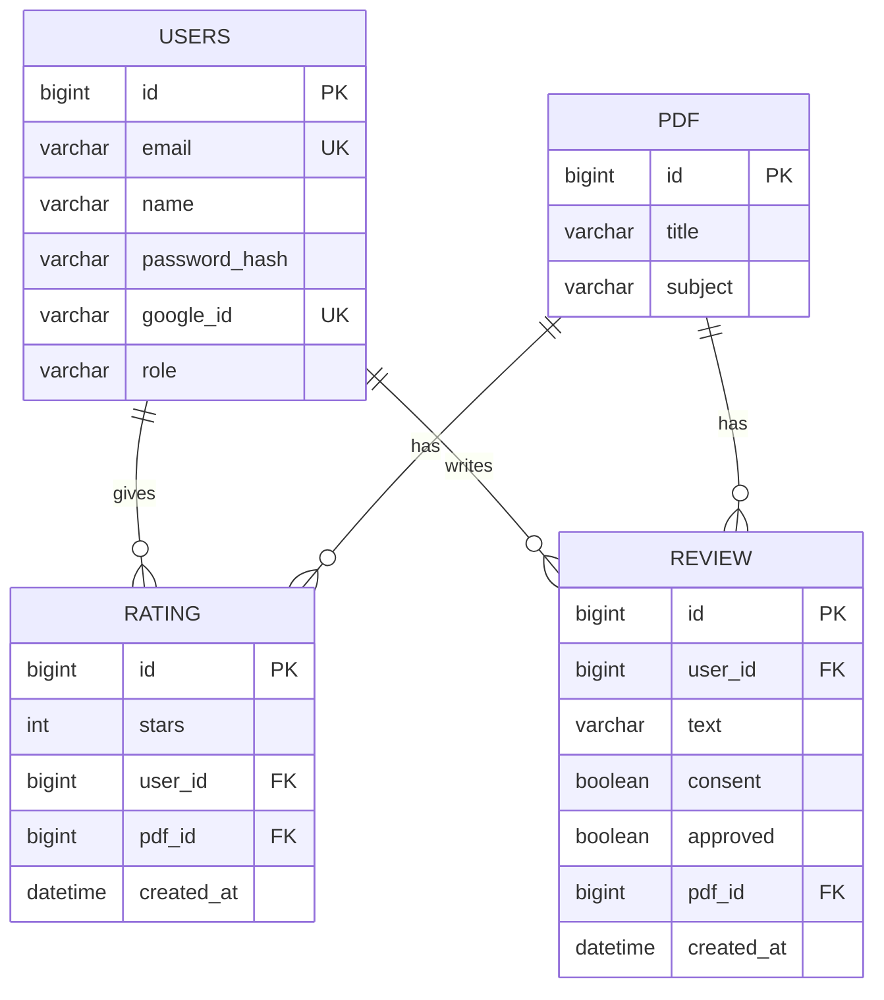

# CrispPrep Reviews & Ratings API

Backend for the ratings and reviews feature of [CrispPrep](https://crispprep.pages.dev), a free study-notes site for government-exam aspirants.

**Stack:** Java 21 · Spring Boot 4 · Spring Security (JWT) · Spring Data JPA (Hibernate) · MySQL 8 · Bean Validation · OpenAPI/Swagger

## Features
- **Accounts:** sign up and log in with email + password (passwords hashed with BCrypt), stateless **JWT** tokens, roles STUDENT / ADMIN
- Logged-in students add **1–5 star ratings**, **one per user per PDF** (409 on a duplicate, also enforced by a unique key)
- **Average rating per PDF** and **top-rated PDFs**, computed in SQL with JOIN, AVG and GROUP BY
- **Consent-based reviews:** one per user per PDF, rejected without consent, public only after admin approval
- **Clean errors:** one JSON shape for every error (400 / 404 / 409 / 500), with the exact field that failed
- **Swagger UI** to explore and test every endpoint

## Endpoints
| Method | Path | What it does |
|---|---|---|
| POST | `/api/auth/register` | Sign up `{"name","email","password"}` → token |
| POST | `/api/auth/login` | Log in `{"email","password"}` → token |
| GET | `/api/me` | Current user (needs token) |
| GET | `/api/pdfs` | List PDFs |
| POST | `/api/pdfs/{id}/ratings` | Rate as the logged-in user `{"stars"}` (token) |
| GET | `/api/pdfs/{id}/summary` | Average rating + count (+ `myRating` with a token) |
| GET | `/api/pdfs/top` | Top 5 PDFs by average rating |
| POST | `/api/pdfs/{id}/reviews` | Review as the logged-in user `{"text","consent"}` (token) |
| GET | `/api/pdfs/{id}/reviews` | Approved reviews only |
| GET | `/api/admin/reviews/pending` | Reviews waiting for approval (ADMIN) |
| PUT | `/api/admin/reviews/{id}/approve` | Approve a review (ADMIN) |

**Access:** `GET /api/pdfs/**` and `/api/auth/**` are public. Everything else needs `Authorization: Bearer <token>`; `/api/admin/**` needs the ADMIN role.

## Database design

`rating` and `review` each have a unique constraint on `(pdf_id, user_id)`.

## Architecture
`Controller → Repository → MySQL`, with DTOs for input and output and a global `@RestControllerAdvice` for errors.

## Run locally
1. Create the database: `CREATE DATABASE crispprep;`
2. Set the secrets (they are never stored in code):
   - `$env:DB_PASSWORD="your-mysql-password"`
   - `$env:JWT_SECRET="at-least-32-random-characters"` (keep the same value between restarts)
   - `$env:ADMIN_EMAIL="you@example.com"` (signing up with this email makes you ADMIN)
3. Run: `./mvnw spring-boot:run`
4. Open: http://localhost:8080/swagger-ui/index.html

## Next steps
- Google sign-in
- Founding Club memberships and payments
- Flyway migrations instead of `ddl-auto=update`
- Unit and integration tests
- Deploy and connect to the CrispPrep website